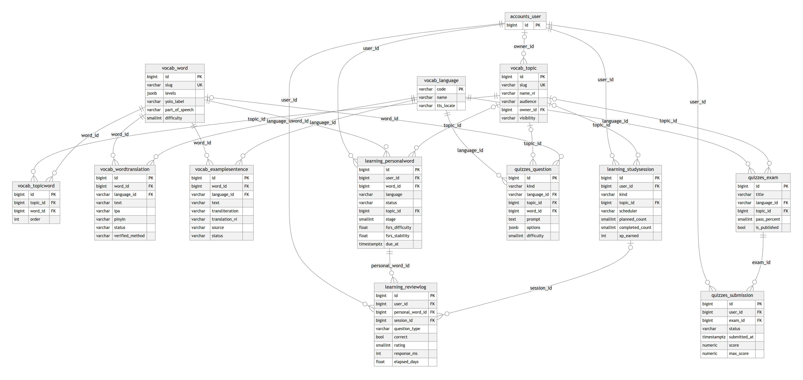
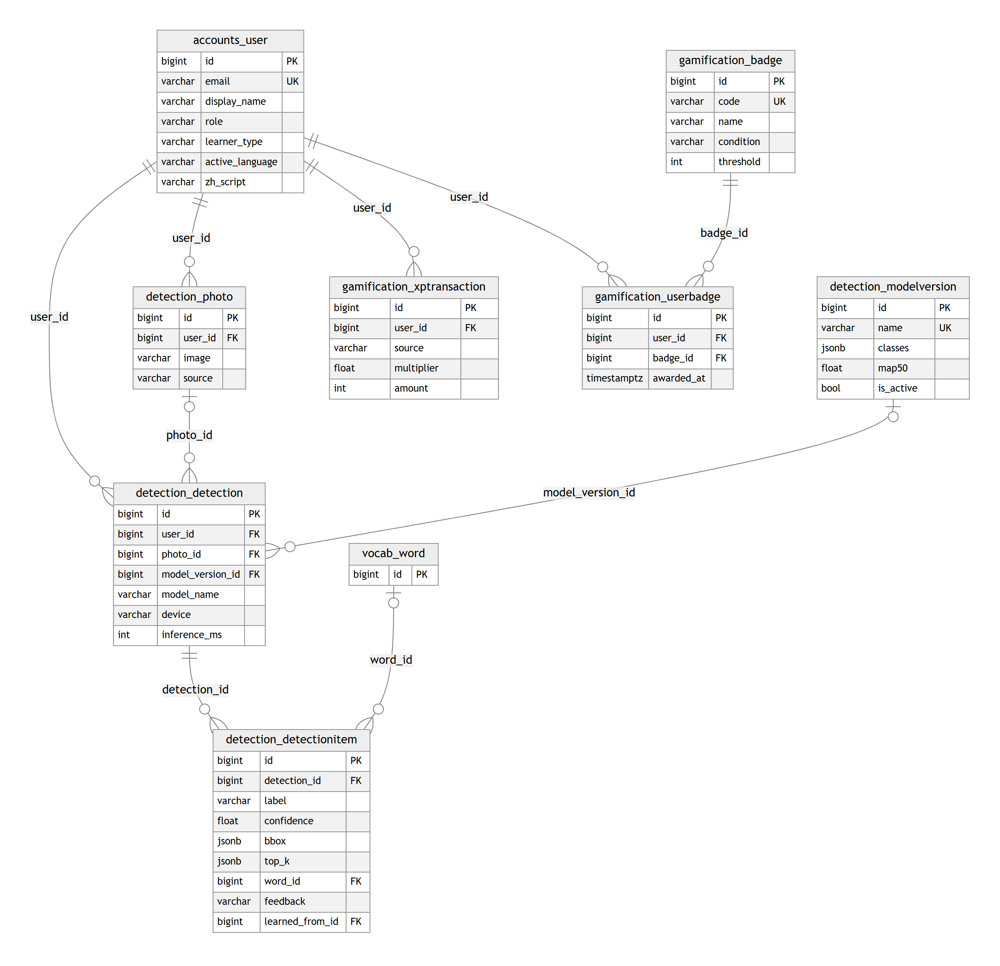
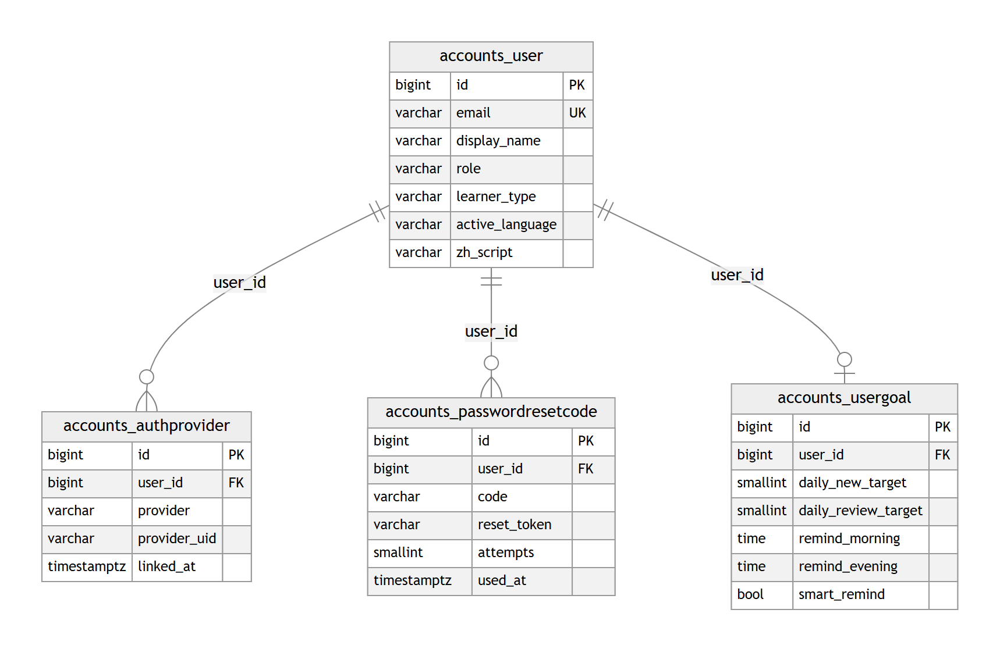
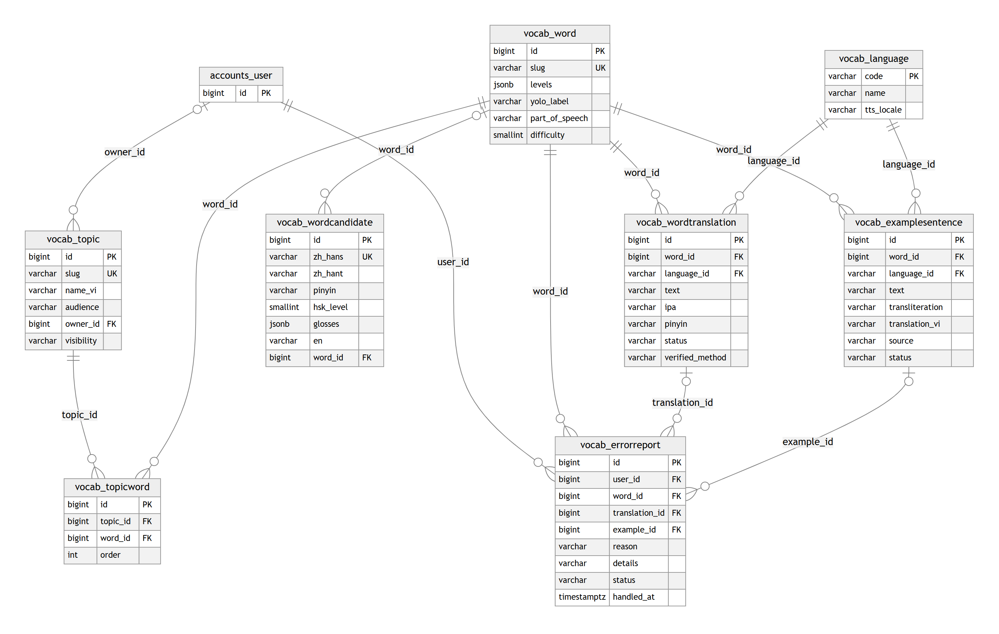
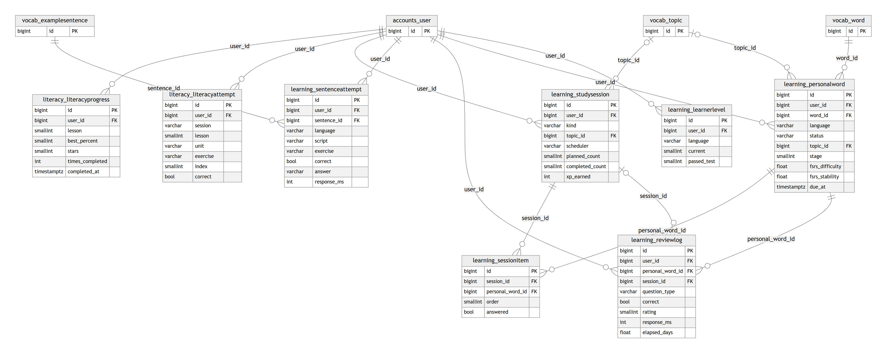
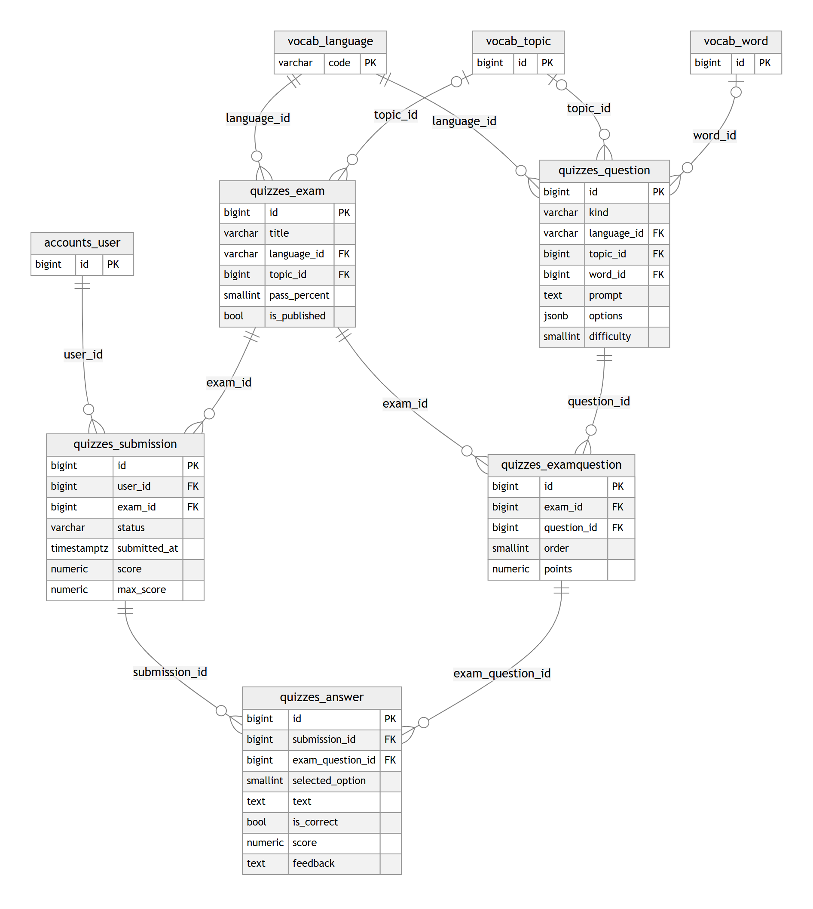
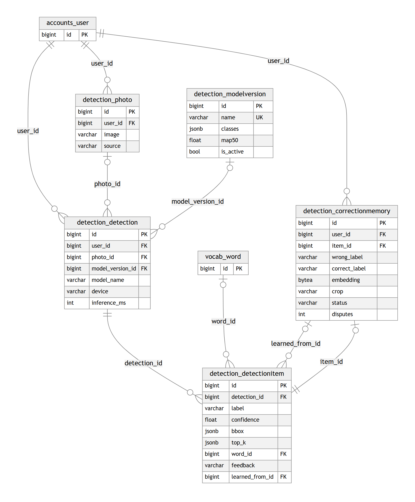
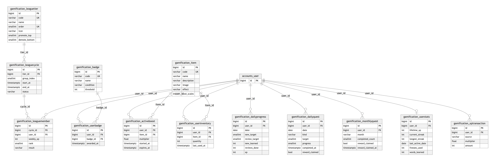
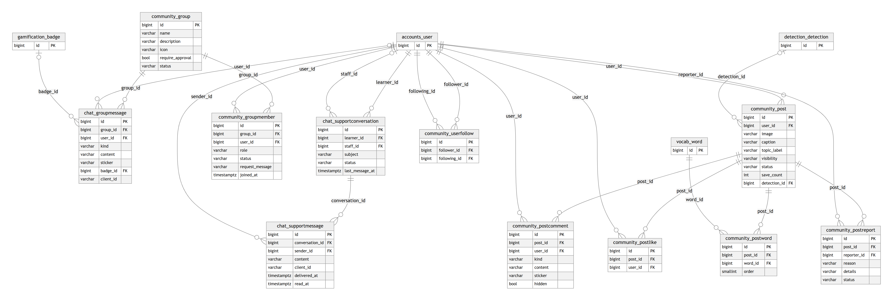
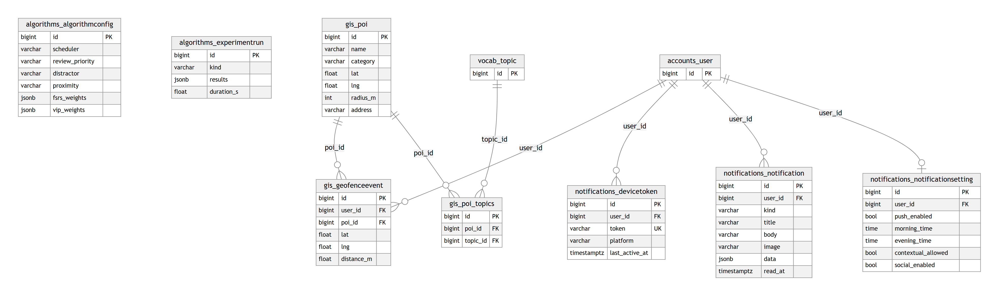

# Cơ sở dữ liệu LingoPrism

> Sinh tự động từ các model Django bằng `docs/database/build_db_docs.py`. Không sửa tay: sửa model rồi chạy lại.

## 1. Cách tổ chức

Hệ quản trị: **PostgreSQL 16** (extension `cube` + `earthdistance` cho truy vấn khoảng cách). Thiết kế theo hai nguyên tắc:

- **Chuẩn hóa 3NF**: mỗi bảng mô tả một thực thể, quan hệ nhiều – nhiều tách thành bảng nối (`vocab_topicword`, `gamification_userbadge`…). Cột JSONB chỉ dùng cho dữ liệu không truy vấn theo từng phần tử (khung ảnh, danh sách phương án, trạng thái thuật toán).
- **Chia module theo nghiệp vụ** (bounded context – Domain-Driven Design, kiến trúc *modular monolith*): mỗi app Django sở hữu các bảng của mình, tên bảng có tiền tố module (`vocab_`, `learning_`…), module khác truy cập qua API / service của module đó.

Tổng **73 bảng** = **20 bảng lõi** (nghiệp vụ chính, ERD mục 2) + **42 bảng phụ trợ** (phụ lục A) + **11 bảng của Django / thư viện** (phụ lục B, không tự thiết kế).

| Module | Bảng lõi | Bảng phụ trợ | Tổng |
|---|---|---|---|
| Người dùng | 1 | 3 | 4 |
| Từ vựng đa ngôn ngữ | 6 | 2 | 8 |
| Học & ôn tập (SRS), luyện đọc viết | 3 | 5 | 8 |
| Câu hỏi & bài kiểm tra | 3 | 2 | 5 |
| Nhận diện ảnh (YOLO) | 4 | 1 | 5 |
| Gamification: XP, chuỗi ngày, nhiệm vụ, giải đấu, cửa hàng | 3 | 10 | 13 |
| Cộng đồng & nhắn tin | 0 | 11 | 11 |
| Bản đồ (GIS), thông báo, cấu hình thuật toán | 0 | 8 | 8 |
| Django / thư viện | – | – | 11 |
| **Tổng** | **20** | **42** | **73** |

## 2. ERD các bảng lõi

**Hình 1 – ERD Từ vựng – học tập – kiểm tra** (bảng `accounts_user` thuộc hình còn lại, chỉ vẽ khóa):



**Hình 2 – ERD Người dùng – nhận diện ảnh – gamification** (bảng `vocab_word` thuộc hình còn lại, chỉ vẽ khóa):



Ký hiệu crow's foot: `||` đúng một, `|o` không hoặc một, `o{` không hoặc nhiều. Để sơ đồ dễ đọc, các khóa ngoại "người tạo / người duyệt" (`created_by_id`, `verified_by_id`, `graded_by_id`…) không vẽ, nhưng có trong từ điển dữ liệu. Sơ đồ chỉ vẽ khóa và các cột chính; đầy đủ ở mục 3.

Luồng dữ liệu chính:

1. **Từ vựng**: `vocab_word` là khái niệm độc lập ngôn ngữ; mỗi ngôn ngữ một dòng `vocab_wordtranslation` (giản thể và phồn thể là hai ngôn ngữ riêng); `vocab_topicword` xếp từ vào chủ đề.
2. **Nhận diện ảnh → học**: `detection_photo` → `detection_detection` → các `detection_detectionitem`; nhãn (`label`) khớp `vocab_word.yolo_label` nên học viên lưu được từ vào `learning_personalword`.
3. **Ôn tập ngắt quãng**: mỗi câu trả lời ghi một `learning_reviewlog` (trạng thái trước / sau) và cập nhật trạng thái SM-2 / FSRS trong `learning_personalword` (`due_at` = lần ôn tiếp theo).
4. **Kiểm tra**: giáo viên soạn `quizzes_exam` từ `quizzes_question`; học viên nộp `quizzes_submission`.
5. **Động lực**: mỗi hoạt động ghi `gamification_xptransaction`; đạt điều kiện thì thêm `gamification_userbadge`.

## 3. Từ điển dữ liệu (bảng lõi)

### 3.1. `accounts_user`

Tài khoản: học viên, giáo viên (staff), quản trị; ngôn ngữ đang học, hồ sơ, số dư vảy / ngọc.

| Cột | Kiểu | Khóa | Null | Mô tả |
|---|---|---|---|---|
| `id` | bigint identity | PK |  | Khóa chính |
| `password` | varchar(128) |  |  | Mật khẩu đã băm (PBKDF2) |
| `last_login` | timestamptz |  | ✓ | Lần đăng nhập cuối |
| `is_superuser` | boolean |  |  | Có mọi quyền |
| `created_at` | timestamptz |  |  | Thời điểm tạo |
| `updated_at` | timestamptz |  |  | Thời điểm cập nhật |
| `email` | varchar(254) | UK |  | Email đăng nhập |
| `display_name` | varchar(80) |  |  | Tên hiển thị |
| `avatar` | varchar(100) |  | ✓ | Ảnh đại diện tải lên |
| `avatar_preset` | varchar(120) |  |  | Ảnh đại diện có sẵn trong app |
| `bio` | varchar(200) |  |  | Giới thiệu ngắn |
| `role` | varchar(10) |  |  | Vai trò. Giá trị: admin, staff, learner |
| `status` | varchar(10) |  |  | Trạng thái. Giá trị: active, locked |
| `learner_type` | varchar(10) |  |  | Loại học viên (trẻ em / người lớn). Giá trị: kid, adult |
| `learning_languages` | jsonb |  |  | Các ngôn ngữ đang học, VD ["en", "zh"] |
| `active_language` | varchar(5) |  |  | Ngôn ngữ đang học hiện tại |
| `zh_script` | varchar(4) |  |  | Chữ Hán đang học: giản thể / phồn thể. Giá trị: hans, hant |
| `show_zhuyin` | boolean |  |  | Hiện chú âm (zhuyin) |
| `birth_date` | date |  | ✓ | Ngày sinh |
| `gender` | varchar(10) |  |  | Giới tính. Giá trị: male, female, other |
| `purpose` | varchar(30) |  |  | Mục đích học |
| `daily_minutes` | smallint |  |  | Số phút học mỗi ngày |
| `onboarding_completed` | boolean |  |  | Đã qua màn hình làm quen |
| `timezone` | varchar(40) |  |  | Múi giờ |
| `scales_balance` | integer |  |  | Số dư vảy (tiền trong app) |
| `gems_balance` | integer |  |  | Số dư ngọc |
| `is_staff` | boolean |  |  | Được vào trang Django Admin |
| `is_active` | boolean |  |  | Tài khoản còn hoạt động |

### 3.2. `vocab_language`

Danh mục ngôn ngữ: vi, en, zh-Hans (giản thể – đại lục), zh-Hant (phồn thể – Đài Loan).

| Cột | Kiểu | Khóa | Null | Mô tả |
|---|---|---|---|---|
| `code` | varchar(8) | PK |  | Mã ngôn ngữ (BCP 47), khóa chính |
| `name` | varchar(60) |  |  | Tên tiếng Việt |
| `native_name` | varchar(60) |  |  | Tên bản ngữ |
| `tts_locale` | varchar(10) |  |  | Giọng đọc (vi-VN, en-US, zh-CN, zh-TW) |
| `order` | smallint |  |  | Thứ tự hiển thị |

### 3.3. `vocab_topic`

Chủ đề từ vựng (động vật, đồ ăn…). Chủ đề hệ thống hoặc do học viên tự tạo.

| Cột | Kiểu | Khóa | Null | Mô tả |
|---|---|---|---|---|
| `id` | bigint identity | PK |  | Khóa chính |
| `created_at` | timestamptz |  |  | Thời điểm tạo |
| `updated_at` | timestamptz |  |  | Thời điểm cập nhật |
| `slug` | varchar(60) | UK |  | Mã định danh |
| `name_vi` | varchar(80) |  |  | Tên tiếng Việt |
| `name_en` | varchar(80) |  |  | Tên tiếng Anh |
| `name_zh_hans` | varchar(40) |  |  | Tên giản thể |
| `name_zh_hant` | varchar(40) |  |  | Tên phồn thể |
| `icon` | varchar(16) |  |  | Biểu tượng (emoji) |
| `image` | varchar(100) |  | ✓ | Ảnh bìa |
| `audience` | varchar(5) |  |  | Đối tượng (tất cả / trẻ em / người lớn). Giá trị: all, kid, adult |
| `owner_id` | bigint | FK | ✓ | Người tạo; trống = chủ đề hệ thống → accounts_user |
| `visibility` | varchar(7) |  |  | Phạm vi hiển thị. Giá trị: public, private |
| `order` | integer |  |  | Thứ tự hiển thị |

### 3.4. `vocab_word`

Khái niệm từ vựng độc lập ngôn ngữ (VD "cat"), gắn với nhãn lớp YOLO để nhận diện ảnh.

| Cột | Kiểu | Khóa | Null | Mô tả |
|---|---|---|---|---|
| `id` | bigint identity | PK |  | Khóa chính |
| `created_at` | timestamptz |  |  | Thời điểm tạo |
| `updated_at` | timestamptz |  |  | Thời điểm cập nhật |
| `slug` | varchar(80) | UK |  | Mã định danh khái niệm |
| `image` | varchar(100) |  | ✓ | Ảnh minh họa tải lên |
| `image_url` | varchar(200) |  |  | Ảnh minh họa (URL) |
| `image_credit` | varchar(300) |  |  | Tác giả · giấy phép ảnh |
| `levels` | jsonb |  |  | Cấp độ 1–4 theo từng ngôn ngữ, VD {"en": 1, "zh": 2} |
| `image_source` | varchar(500) |  |  | Trang gốc của ảnh (Wikimedia Commons) |
| `emoji` | varchar(16) |  |  | Emoji minh họa cho trẻ em |
| `yolo_label` | varchar(60) |  |  | Nhãn lớp YOLO tương ứng (nối kết quả nhận diện với từ) |
| `part_of_speech` | varchar(6) |  |  | Từ loại. Giá trị: noun, verb, adj, adv, phrase, other |
| `difficulty` | smallint |  |  | Độ khó 1–5 |
| `audience` | varchar(5) |  |  | Đối tượng (tất cả / trẻ em / người lớn). Giá trị: all, kid, adult |
| `created_by_id` | bigint | FK | ✓ | Người tạo → accounts_user |

### 3.5. `vocab_topicword`

Bảng nối nhiều – nhiều giữa chủ đề và từ.

| Cột | Kiểu | Khóa | Null | Mô tả |
|---|---|---|---|---|
| `id` | bigint identity | PK |  | Khóa chính |
| `topic_id` | bigint | FK |  | Chủ đề → vocab_topic |
| `word_id` | bigint | FK |  | Từ vựng → vocab_word |
| `order` | integer |  |  | Thứ tự hiển thị |

Ràng buộc duy nhất: (topic, word).

### 3.6. `vocab_wordtranslation`

Cách viết của một từ trong một ngôn ngữ: phiên âm, pinyin/zhuyin, trạng thái kiểm duyệt.

| Cột | Kiểu | Khóa | Null | Mô tả |
|---|---|---|---|---|
| `id` | bigint identity | PK |  | Khóa chính |
| `created_at` | timestamptz |  |  | Thời điểm tạo |
| `updated_at` | timestamptz |  |  | Thời điểm cập nhật |
| `word_id` | bigint | FK |  | Từ vựng → vocab_word |
| `language_id` | varchar(8) | FK |  | Ngôn ngữ → vocab_language |
| `text` | varchar(120) |  |  | Từ viết trong ngôn ngữ đó |
| `ipa` | varchar(120) |  |  | Phiên âm IPA (tiếng Anh – giọng Mỹ) |
| `pinyin` | varchar(120) |  |  | Pinyin có dấu thanh |
| `pinyin_numbered` | varchar(120) |  |  | Pinyin đánh số thanh, VD ma3 |
| `zhuyin` | varchar(120) |  |  | Chú âm phù hiệu |
| `measure_word` | varchar(20) |  |  | Lượng từ (隻 / 只) |
| `accepted_variants` | jsonb |  |  | Các dạng viết khác được chấp nhận khi chấm |
| `regional_difference` | boolean |  |  | Giản / phồn khác từ theo vùng (土豆 / 馬鈴薯) |
| `meaning_vi` | varchar(255) |  |  | Nghĩa tiếng Việt |
| `meaning_en` | varchar(255) |  |  | Nghĩa tiếng Anh |
| `level` | varchar(20) |  |  | Cấp HSK / TOCFL / CEFR |
| `audio` | varchar(100) |  | ✓ | File phát âm |
| `status` | varchar(8) |  |  | Trạng thái. Giá trị: draft, verified, flagged, rejected |
| `sources` | jsonb |  |  | Dữ liệu đối chiếu từ các nguồn (CC-CEDICT, MOE…) |
| `issues` | jsonb |  |  | Lỗi do bộ kiểm tra tự động phát hiện |
| `verified_method` | varchar(10) |  |  | Cách duyệt: tự động / thủ công |
| `verified_at` | timestamptz |  | ✓ | Thời điểm duyệt |
| `verified_by_id` | bigint | FK | ✓ | Người duyệt → accounts_user |

Ràng buộc duy nhất: (word, language).

### 3.7. `vocab_examplesentence`

Câu ví dụ có nguồn (Tatoeba / thủ công), đã tách từ để làm bài sắp xếp câu.

| Cột | Kiểu | Khóa | Null | Mô tả |
|---|---|---|---|---|
| `id` | bigint identity | PK |  | Khóa chính |
| `created_at` | timestamptz |  |  | Thời điểm tạo |
| `updated_at` | timestamptz |  |  | Thời điểm cập nhật |
| `word_id` | bigint | FK |  | Từ vựng → vocab_word |
| `language_id` | varchar(8) | FK |  | Ngôn ngữ → vocab_language |
| `text` | varchar(300) |  |  | Câu ví dụ |
| `transliteration` | varchar(400) |  |  | Phiên âm của câu (pinyin) |
| `translation_vi` | varchar(300) |  |  | Bản dịch tiếng Việt |
| `translation_en` | varchar(300) |  |  | Bản dịch tiếng Anh |
| `source` | varchar(30) |  |  | Nguồn (tatoeba / thủ công) |
| `source_id` | varchar(40) |  |  | Mã câu ở nguồn |
| `license` | varchar(40) |  |  | Giấy phép |
| `status` | varchar(8) |  |  | Trạng thái. Giá trị: draft, verified, flagged, rejected |
| `tokens` | jsonb |  |  | Câu đã tách từ (kèm pinyin / zhuyin) |
| `target_tokens` | jsonb |  |  | Vị trí các token là từ vựng đang học |
| `checks` | jsonb |  |  | Lỗi / cảnh báo của bộ kiểm tra tự động |

Ràng buộc duy nhất: (word, language, source, source_id).

### 3.8. `learning_personalword`

Từ trong thư viện của học viên kèm trạng thái lặp lại ngắt quãng (SM-2 / FSRS).

| Cột | Kiểu | Khóa | Null | Mô tả |
|---|---|---|---|---|
| `id` | bigint identity | PK |  | Khóa chính |
| `created_at` | timestamptz |  |  | Thời điểm tạo |
| `updated_at` | timestamptz |  |  | Thời điểm cập nhật |
| `user_id` | bigint | FK |  | Người dùng → accounts_user |
| `word_id` | bigint | FK |  | Từ vựng → vocab_word |
| `language` | varchar(2) |  |  | Mã ngôn ngữ đang học (vi, en, zh). Giá trị: vi, en, zh |
| `status` | varchar(8) |  |  | Trạng thái học (mới / đang học / đã thuộc…). Giá trị: new, learning, mastered |
| `source` | varchar(10) |  |  | Từ được thêm từ đâu (chủ đề, ảnh, bài đăng…). Giá trị: topic, camera, manual, community, location |
| `topic_id` | bigint | FK | ✓ | Chủ đề → vocab_topic |
| `source_ref` | varchar(64) |  |  | Mã đối tượng nguồn (VD id ảnh nhận diện) |
| `stage` | smallint |  |  | Giai đoạn ghi nhớ |
| `ease` | double |  |  | Hệ số dễ (SM-2) |
| `interval_days` | integer |  |  | Khoảng cách ôn hiện tại (ngày) |
| `repetitions` | integer |  |  | Số lần nhớ đúng liên tiếp |
| `lapses` | integer |  |  | Số lần quên |
| `wrong_streak` | integer |  |  | Số lần sai liên tiếp |
| `fsrs_difficulty` | double |  |  | Độ khó D của FSRS (1–10) |
| `fsrs_stability` | double |  |  | Độ ổn định S của FSRS (ngày) |
| `due_at` | timestamptz |  | ✓ | Thời điểm đến hạn ôn |
| `first_learned_at` | timestamptz |  | ✓ | Lần học đầu tiên |
| `last_reviewed_at` | timestamptz |  | ✓ | Lần ôn gần nhất |

Ràng buộc duy nhất: (user, word, language).

### 3.9. `learning_studysession`

Một phiên học / ôn tập.

| Cột | Kiểu | Khóa | Null | Mô tả |
|---|---|---|---|---|
| `id` | bigint identity | PK |  | Khóa chính |
| `created_at` | timestamptz |  |  | Thời điểm tạo |
| `updated_at` | timestamptz |  |  | Thời điểm cập nhật |
| `user_id` | bigint | FK |  | Người dùng → accounts_user |
| `language` | varchar(2) |  |  | Mã ngôn ngữ đang học (vi, en, zh). Giá trị: vi, en, zh |
| `script` | varchar(4) |  |  | Chữ Hán của phiên (giản / phồn) |
| `kind` | varchar(8) |  |  | Loại phiên (học mới / ôn tập…). Giá trị: learn, review, practice |
| `topic_id` | bigint | FK | ✓ | Chủ đề → vocab_topic |
| `scheduler` | varchar(20) |  |  | Thuật toán lập lịch dùng (SM-2 / FSRS) |
| `planned_count` | smallint |  |  | Số từ dự kiến |
| `completed_count` | smallint |  |  | Số từ đã làm |
| `correct_first_try` | smallint |  |  | Số từ đúng ngay lần đầu |
| `xp_earned` | integer |  |  | XP nhận được |
| `started_at` | timestamptz |  |  | Bắt đầu |
| `ended_at` | timestamptz |  | ✓ | Kết thúc |

### 3.10. `learning_reviewlog`

Mỗi câu trả lời của học viên – dữ liệu gốc để lập lịch và đánh giá thuật toán SM-2 / FSRS.

| Cột | Kiểu | Khóa | Null | Mô tả |
|---|---|---|---|---|
| `id` | bigint identity | PK |  | Khóa chính |
| `user_id` | bigint | FK |  | Người dùng → accounts_user |
| `personal_word_id` | bigint | FK |  | Từ của học viên được ôn → learning_personalword |
| `session_id` | bigint | FK | ✓ | Phiên học → learning_studysession |
| `language` | varchar(2) |  |  | Mã ngôn ngữ đang học (vi, en, zh). Giá trị: vi, en, zh |
| `script` | varchar(4) |  |  | Chữ Hán (giản / phồn) |
| `question_type` | varchar(30) |  |  | Dạng câu hỏi |
| `correct` | boolean |  |  | Trả lời đúng |
| `first_try` | boolean |  |  | Đúng ngay lần đầu |
| `rating` | smallint |  |  | Điểm 0–5 (chất lượng SM-2) |
| `response_ms` | integer |  | ✓ | Thời gian trả lời (ms) |
| `answer` | varchar(200) |  |  | Câu trả lời |
| `scheduler` | varchar(20) |  |  | Thuật toán lập lịch |
| `state_before` | jsonb |  |  | Trạng thái nhớ trước khi trả lời |
| `state_after` | jsonb |  |  | Trạng thái nhớ sau khi trả lời |
| `elapsed_days` | double |  | ✓ | Số ngày kể từ lần ôn trước |
| `created_at` | timestamptz |  |  | Thời điểm tạo |

### 3.11. `quizzes_question`

Ngân hàng câu hỏi (trắc nghiệm, điền từ…).

| Cột | Kiểu | Khóa | Null | Mô tả |
|---|---|---|---|---|
| `id` | bigint identity | PK |  | Khóa chính |
| `created_at` | timestamptz |  |  | Thời điểm tạo |
| `updated_at` | timestamptz |  |  | Thời điểm cập nhật |
| `kind` | varchar(5) |  |  | Dạng câu hỏi. Giá trị: mcq, fill, essay |
| `language_id` | varchar(8) | FK |  | Ngôn ngữ của câu hỏi → vocab_language |
| `topic_id` | bigint | FK | ✓ | Chủ đề → vocab_topic |
| `word_id` | bigint | FK | ✓ | Từ vựng liên quan → vocab_word |
| `prompt` | text |  |  | Đề bài |
| `image_url` | varchar(300) |  |  | Ảnh minh họa |
| `options` | jsonb |  |  | Các lựa chọn trắc nghiệm (JSON) |
| `accepted_answers` | jsonb |  |  | Đáp án đúng cho câu điền từ |
| `explanation` | text |  |  | Giải thích |
| `difficulty` | smallint |  |  | Độ khó |
| `created_by_id` | bigint | FK | ✓ | Người tạo → accounts_user |

### 3.12. `quizzes_exam`

Đề kiểm tra do giáo viên soạn.

| Cột | Kiểu | Khóa | Null | Mô tả |
|---|---|---|---|---|
| `id` | bigint identity | PK |  | Khóa chính |
| `created_at` | timestamptz |  |  | Thời điểm tạo |
| `updated_at` | timestamptz |  |  | Thời điểm cập nhật |
| `title` | varchar(150) |  |  | Tên đề |
| `description` | text |  |  | Mô tả |
| `language_id` | varchar(8) | FK |  | Ngôn ngữ → vocab_language |
| `topic_id` | bigint | FK | ✓ | Chủ đề → vocab_topic |
| `audience` | varchar(5) |  |  | Đối tượng (tất cả / trẻ em / người lớn) |
| `time_limit_minutes` | smallint |  | ✓ | Thời gian làm bài (phút) |
| `pass_percent` | smallint |  |  | Tỉ lệ điểm đạt (%) |
| `is_published` | boolean |  |  | Đã công bố |
| `created_by_id` | bigint | FK | ✓ | Người tạo → accounts_user |

### 3.13. `quizzes_submission`

Bài làm của học viên cho một đề, điểm và nhận xét.

| Cột | Kiểu | Khóa | Null | Mô tả |
|---|---|---|---|---|
| `id` | bigint identity | PK |  | Khóa chính |
| `user_id` | bigint | FK |  | Người dùng → accounts_user |
| `exam_id` | bigint | FK |  | Đề kiểm tra → quizzes_exam |
| `status` | varchar(12) |  |  | Trạng thái. Giá trị: in_progress, submitted, graded |
| `started_at` | timestamptz |  |  | Bắt đầu làm |
| `submitted_at` | timestamptz |  | ✓ | Nộp bài |
| `score` | numeric(6, 2) |  |  | Điểm |
| `max_score` | numeric(6, 2) |  |  | Điểm tối đa |
| `feedback` | text |  |  | Nhận xét của giáo viên |
| `graded_by_id` | bigint | FK | ✓ | Người chấm → accounts_user |
| `graded_at` | timestamptz |  | ✓ | Thời điểm chấm |

### 3.14. `detection_modelversion`

Phiên bản model nhận diện: danh sách lớp, chỉ số đánh giá, model đang dùng.

| Cột | Kiểu | Khóa | Null | Mô tả |
|---|---|---|---|---|
| `id` | bigint identity | PK |  | Khóa chính |
| `name` | varchar(60) | UK |  | Tên phiên bản |
| `file` | varchar(300) |  |  | Đường dẫn file ONNX trên server |
| `classes` | jsonb |  |  | Danh sách nhãn theo thứ tự lớp |
| `input_size` | smallint |  |  | Kích thước ảnh đầu vào (px) |
| `precision` | double |  | ✓ | Precision trên tập test |
| `recall` | double |  | ✓ | Recall trên tập test |
| `map50` | double |  | ✓ | mAP@0.5 |
| `map50_95` | double |  | ✓ | mAP@0.5:0.95 |
| `notes` | text |  |  | Ghi chú cách đo |
| `is_active` | boolean |  |  | Model đang dùng |
| `created_at` | timestamptz |  |  | Thời điểm tạo |

### 3.15. `detection_photo`

Ảnh học viên chụp / tải lên.

| Cột | Kiểu | Khóa | Null | Mô tả |
|---|---|---|---|---|
| `id` | bigint identity | PK |  | Khóa chính |
| `user_id` | bigint | FK |  | Người dùng → accounts_user |
| `image` | varchar(100) |  | ✓ | File ảnh |
| `width` | integer |  |  | Chiều rộng (px) |
| `height` | integer |  |  | Chiều cao (px) |
| `source` | varchar(7) |  |  | Nguồn (camera / thư viện ảnh). Giá trị: camera, gallery, web |
| `created_at` | timestamptz |  |  | Thời điểm tạo |

### 3.16. `detection_detection`

Một lần nhận diện ảnh (model, thiết bị, thời gian suy luận).

| Cột | Kiểu | Khóa | Null | Mô tả |
|---|---|---|---|---|
| `id` | bigint identity | PK |  | Khóa chính |
| `user_id` | bigint | FK |  | Người dùng → accounts_user |
| `photo_id` | bigint | FK | ✓ | Ảnh → detection_photo |
| `model_version_id` | bigint | FK | ✓ | Phiên bản model → detection_modelversion |
| `model_name` | varchar(60) |  |  | Tên model đã chạy |
| `device` | varchar(9) |  |  | Nơi chạy (server / điện thoại). Giá trị: server, on_device |
| `inference_ms` | integer |  | ✓ | Thời gian suy luận (ms) |
| `confirmed` | boolean |  |  | Học viên đã xác nhận kết quả |
| `created_at` | timestamptz |  |  | Thời điểm tạo |

### 3.17. `detection_detectionitem`

Một vật nhận diện được: nhãn, độ tin cậy, khung, phương án thay thế, phản hồi đúng / sai.

| Cột | Kiểu | Khóa | Null | Mô tả |
|---|---|---|---|---|
| `id` | bigint identity | PK |  | Khóa chính |
| `detection_id` | bigint | FK |  | Lần nhận diện → detection_detection |
| `label` | varchar(60) |  |  | Nhãn model trả về |
| `confidence` | double |  |  | Độ tin cậy 0–1 |
| `bbox` | jsonb |  |  | Khung [x1, y1, x2, y2] chuẩn hóa 0–1 |
| `top_k` | jsonb |  |  | Các nhãn thay thế và độ tin cậy |
| `word_id` | bigint | FK | ✓ | Từ vựng ứng với nhãn → vocab_word |
| `selected` | boolean |  |  | Học viên chọn lưu từ này |
| `feedback` | varchar(7) |  |  | Phản hồi đúng / sai. Giá trị: unknown, correct, wrong |
| `corrected_label` | varchar(60) |  |  | Nhãn đúng do học viên chọn |
| `learned_from_id` | bigint | FK | ✓ | Đã tự sửa nhãn theo bộ nhớ sửa lỗi → detection_correctionmemory |

### 3.18. `gamification_xptransaction`

Sổ cái điểm kinh nghiệm (XP): mỗi lần cộng điểm và lý do.

| Cột | Kiểu | Khóa | Null | Mô tả |
|---|---|---|---|---|
| `id` | bigint identity | PK |  | Khóa chính |
| `user_id` | bigint | FK |  | Người dùng → accounts_user |
| `source` | varchar(10) |  |  | Nguồn XP (học, ôn, nhiệm vụ…). Giá trị: learn, review, practice, exam, quest, camera, community, admin |
| `source_id` | varchar(40) |  |  | Mã đối tượng nguồn |
| `base_amount` | integer |  |  | XP gốc |
| `multiplier` | double |  |  | Hệ số nhân (boost) |
| `amount` | integer |  |  | XP thực nhận (sau boost, giới hạn ngày) |
| `note` | varchar(200) |  |  | Ghi chú |
| `created_at` | timestamptz |  |  | Thời điểm tạo |

### 3.19. `gamification_badge`

Danh mục huy hiệu và điều kiện đạt.

| Cột | Kiểu | Khóa | Null | Mô tả |
|---|---|---|---|---|
| `id` | bigint identity | PK |  | Khóa chính |
| `code` | varchar(50) | UK |  | Mã huy hiệu |
| `name` | varchar(80) |  |  | Tên |
| `description` | varchar(200) |  |  | Mô tả |
| `icon` | varchar(200) |  |  | Ảnh huy hiệu |
| `sticker` | varchar(200) |  |  | Sticker thưởng kèm |
| `condition` | varchar(16) |  |  | Loại điều kiện. Giá trị: xp, streak, words_learned, words_mastered, detections, posts |
| `threshold` | integer |  |  | Ngưỡng cần đạt |
| `order` | smallint |  |  | Thứ tự hiển thị |

### 3.20. `gamification_userbadge`

Huy hiệu học viên đã đạt.

| Cột | Kiểu | Khóa | Null | Mô tả |
|---|---|---|---|---|
| `id` | bigint identity | PK |  | Khóa chính |
| `user_id` | bigint | FK |  | Người dùng → accounts_user |
| `badge_id` | bigint | FK |  | Huy hiệu → gamification_badge |
| `awarded_at` | timestamptz |  |  | Thời điểm đạt |

Ràng buộc duy nhất: (user, badge).

## Phụ lục A. Bảng phụ trợ theo module

### Người dùng



| Bảng | Vai trò | Khóa ngoại |
|---|---|---|
| `accounts_authprovider` | Tài khoản liên kết đăng nhập ngoài (Google). | `user_id` → accounts_user |
| `accounts_passwordresetcode` | Mã 6 số quên mật khẩu gửi qua email. | `user_id` → accounts_user |
| `accounts_user` *(lõi)* | Tài khoản: học viên, giáo viên (staff), quản trị; ngôn ngữ đang học, hồ sơ, số dư vảy / ngọc. | – |
| `accounts_usergoal` | Mục tiêu học mỗi ngày và giờ nhắc học (1 – 1 với user). | `user_id` → accounts_user |

### Từ vựng đa ngôn ngữ



| Bảng | Vai trò | Khóa ngoại |
|---|---|---|
| `vocab_errorreport` | Học viên báo lỗi bản dịch / câu ví dụ; giáo viên xử lý. | `user_id` → accounts_user, `word_id` → vocab_word, `translation_id` → vocab_wordtranslation, `example_id` → vocab_examplesentence, `handled_by_id` → accounts_user |
| `vocab_examplesentence` *(lõi)* | Câu ví dụ có nguồn (Tatoeba / thủ công), đã tách từ để làm bài sắp xếp câu. | `word_id` → vocab_word, `language_id` → vocab_language |
| `vocab_language` *(lõi)* | Danh mục ngôn ngữ: vi, en, zh-Hans (giản thể – đại lục), zh-Hant (phồn thể – Đài Loan). | – |
| `vocab_topic` *(lõi)* | Chủ đề từ vựng (động vật, đồ ăn…). Chủ đề hệ thống hoặc do học viên tự tạo. | `owner_id` → accounts_user |
| `vocab_topicword` *(lõi)* | Bảng nối nhiều – nhiều giữa chủ đề và từ. | `topic_id` → vocab_topic, `word_id` → vocab_word |
| `vocab_word` *(lõi)* | Khái niệm từ vựng độc lập ngôn ngữ (VD "cat"), gắn với nhãn lớp YOLO để nhận diện ảnh. | `created_by_id` → accounts_user |
| `vocab_wordcandidate` | Từ mới đề xuất từ danh sách HSK (CC-CEDICT + Wiktionary) chờ giáo viên duyệt. | `word_id` → vocab_word, `reviewed_by_id` → accounts_user |
| `vocab_wordtranslation` *(lõi)* | Cách viết của một từ trong một ngôn ngữ: phiên âm, pinyin/zhuyin, trạng thái kiểm duyệt. | `word_id` → vocab_word, `language_id` → vocab_language, `verified_by_id` → accounts_user |

### Học & ôn tập (SRS), luyện đọc viết



| Bảng | Vai trò | Khóa ngoại |
|---|---|---|
| `learning_learnerlevel` | Cấp độ (1–4) học viên đang học ở mỗi ngôn ngữ. | `user_id` → accounts_user |
| `learning_personalword` *(lõi)* | Từ trong thư viện của học viên kèm trạng thái lặp lại ngắt quãng (SM-2 / FSRS). | `user_id` → accounts_user, `word_id` → vocab_word, `topic_id` → vocab_topic |
| `learning_reviewlog` *(lõi)* | Mỗi câu trả lời của học viên – dữ liệu gốc để lập lịch và đánh giá thuật toán SM-2 / FSRS. | `user_id` → accounts_user, `personal_word_id` → learning_personalword, `session_id` → learning_studysession |
| `learning_sentenceattempt` | Câu trả lời bài tập câu (sắp xếp, nghe, điền, nghĩa). | `user_id` → accounts_user, `sentence_id` → vocab_examplesentence |
| `learning_sessionitem` | Các từ trong một phiên học và thứ tự. | `session_id` → learning_studysession, `personal_word_id` → learning_personalword |
| `learning_studysession` *(lõi)* | Một phiên học / ôn tập. | `user_id` → accounts_user, `topic_id` → vocab_topic |
| `literacy_literacyattempt` | Từng câu trả lời luyện đọc – viết (phân tích âm / vần / thanh hay nhầm). | `user_id` → accounts_user |
| `literacy_literacyprogress` | Kết quả tốt nhất của trẻ ở mỗi bài học đọc – viết. | `user_id` → accounts_user |

### Câu hỏi & bài kiểm tra



| Bảng | Vai trò | Khóa ngoại |
|---|---|---|
| `quizzes_answer` | Câu trả lời từng câu trong bài làm. | `submission_id` → quizzes_submission, `exam_question_id` → quizzes_examquestion |
| `quizzes_exam` *(lõi)* | Đề kiểm tra do giáo viên soạn. | `language_id` → vocab_language, `topic_id` → vocab_topic, `created_by_id` → accounts_user |
| `quizzes_examquestion` | Câu hỏi trong đề, thứ tự và điểm. | `exam_id` → quizzes_exam, `question_id` → quizzes_question |
| `quizzes_question` *(lõi)* | Ngân hàng câu hỏi (trắc nghiệm, điền từ…). | `language_id` → vocab_language, `topic_id` → vocab_topic, `word_id` → vocab_word, `created_by_id` → accounts_user |
| `quizzes_submission` *(lõi)* | Bài làm của học viên cho một đề, điểm và nhận xét. | `user_id` → accounts_user, `exam_id` → quizzes_exam, `graded_by_id` → accounts_user |

### Nhận diện ảnh (YOLO)



| Bảng | Vai trò | Khóa ngoại |
|---|---|---|
| `detection_correctionmemory` | Bộ nhớ sửa lỗi: vật bị nhận sai được ghi nhớ theo đặc trưng ảnh để lần sau tự sửa nhãn. | `user_id` → accounts_user, `item_id` → detection_detectionitem, `reviewed_by_id` → accounts_user |
| `detection_detection` *(lõi)* | Một lần nhận diện ảnh (model, thiết bị, thời gian suy luận). | `user_id` → accounts_user, `photo_id` → detection_photo, `model_version_id` → detection_modelversion |
| `detection_detectionitem` *(lõi)* | Một vật nhận diện được: nhãn, độ tin cậy, khung, phương án thay thế, phản hồi đúng / sai. | `detection_id` → detection_detection, `word_id` → vocab_word, `learned_from_id` → detection_correctionmemory |
| `detection_modelversion` *(lõi)* | Phiên bản model nhận diện: danh sách lớp, chỉ số đánh giá, model đang dùng. | – |
| `detection_photo` *(lõi)* | Ảnh học viên chụp / tải lên. | `user_id` → accounts_user |

### Gamification: XP, chuỗi ngày, nhiệm vụ, giải đấu, cửa hàng



| Bảng | Vai trò | Khóa ngoại |
|---|---|---|
| `gamification_activeboost` | Hiệu ứng nhân XP đang có hiệu lực. | `user_id` → accounts_user, `item_id` → gamification_item |
| `gamification_badge` *(lõi)* | Danh mục huy hiệu và điều kiện đạt. | – |
| `gamification_dailyprogress` | Tiến độ học từng ngày (mục tiêu, số từ mới, số lượt ôn, XP). | `user_id` → accounts_user |
| `gamification_dailyquest` | Nhiệm vụ hằng ngày của học viên. | `user_id` → accounts_user |
| `gamification_item` | Vật phẩm trong cửa hàng (đóng băng chuỗi, nhân XP…). | – |
| `gamification_leaguecycle` | Một mùa giải tuần của một nhóm trong một hạng. | `tier_id` → gamification_leaguetier |
| `gamification_leaguemember` | Học viên trong mùa giải: XP tuần, thứ hạng, lên / xuống hạng. | `cycle_id` → gamification_leaguecycle, `user_id` → accounts_user |
| `gamification_leaguetier` | Các hạng giải đấu tuần (10 hạng Lăng Kính). | – |
| `gamification_monthlyquest` | Nhiệm vụ tháng (đếm số ngày hoàn thành nhiệm vụ). | `user_id` → accounts_user |
| `gamification_userbadge` *(lõi)* | Huy hiệu học viên đã đạt. | `user_id` → accounts_user, `badge_id` → gamification_badge |
| `gamification_userinventory` | Túi đồ: vật phẩm học viên sở hữu. | `user_id` → accounts_user, `item_id` → gamification_item |
| `gamification_userstats` | Bộ đếm tổng hợp (XP, chuỗi ngày, số từ…) để trang chủ / bảng xếp hạng truy vấn nhanh. | `user_id` → accounts_user |
| `gamification_xptransaction` *(lõi)* | Sổ cái điểm kinh nghiệm (XP): mỗi lần cộng điểm và lý do. | `user_id` → accounts_user |

### Cộng đồng & nhắn tin



| Bảng | Vai trò | Khóa ngoại |
|---|---|---|
| `chat_groupmessage` | Tin nhắn trong nhóm học. | `group_id` → community_group, `user_id` → accounts_user, `badge_id` → gamification_badge |
| `chat_supportconversation` | Cuộc hội thoại hỗ trợ giữa học viên và nhân viên. | `learner_id` → accounts_user, `staff_id` → accounts_user |
| `chat_supportmessage` | Tin nhắn hỗ trợ. | `conversation_id` → chat_supportconversation, `sender_id` → accounts_user |
| `community_group` | Nhóm học. | `created_by_id` → accounts_user |
| `community_groupmember` | Thành viên nhóm, vai trò, trạng thái duyệt. | `group_id` → community_group, `user_id` → accounts_user |
| `community_post` | Bài đăng ảnh kèm từ vựng nhận diện được. | `user_id` → accounts_user, `detection_id` → detection_detection |
| `community_postcomment` | Bình luận (chữ / sticker). | `post_id` → community_post, `user_id` → accounts_user |
| `community_postlike` | Lượt thích bài đăng. | `post_id` → community_post, `user_id` → accounts_user |
| `community_postreport` | Báo cáo vi phạm bài đăng. | `post_id` → community_post, `reporter_id` → accounts_user, `handled_by_id` → accounts_user |
| `community_postword` | Từ vựng gắn với bài đăng. | `post_id` → community_post, `word_id` → vocab_word |
| `community_userfollow` | Quan hệ theo dõi giữa người dùng. | `follower_id` → accounts_user, `following_id` → accounts_user |

### Bản đồ (GIS), thông báo, cấu hình thuật toán



| Bảng | Vai trò | Khóa ngoại |
|---|---|---|
| `algorithms_algorithmconfig` | Cấu hình thuật toán đang dùng (lập lịch, chọn đáp án nhiễu, trọng số) – 1 dòng. | – |
| `algorithms_experimentrun` | Kết quả các lần chạy thực nghiệm so sánh thuật toán. | – |
| `gis_geofenceevent` | Lần học viên đi vào vùng của một địa điểm. | `user_id` → accounts_user, `poi_id` → gis_poi |
| `gis_poi` | Địa điểm (bảo tàng, chợ…) gợi ý chủ đề khi học viên đến gần; chỉ mục không gian GiST. | `created_by_id` → accounts_user |
| `gis_poi_topics` | Bảng nối nhiều – nhiều địa điểm – chủ đề. | `poi_id` → gis_poi, `topic_id` → vocab_topic |
| `notifications_devicetoken` | Token thiết bị để gửi thông báo đẩy (FCM). | `user_id` → accounts_user |
| `notifications_notification` | Thông báo trong app. | `user_id` → accounts_user |
| `notifications_notificationsetting` | Cài đặt nhận thông báo của người dùng. | `user_id` → accounts_user |

## Phụ lục B. Bảng của Django và thư viện

Do Django (`auth`, `admin`, `sessions`, `contenttypes`) và SimpleJWT tạo, không thuộc thiết kế nghiệp vụ.

| Bảng | Vai trò |
|---|---|
| `accounts_user_groups` | Django: nhóm quyền của người dùng. |
| `accounts_user_user_permissions` | Django: quyền riêng của người dùng. |
| `auth_group` | Django: nhóm quyền. |
| `auth_group_permissions` | Django: quyền của nhóm. |
| `auth_permission` | Django: danh mục quyền. |
| `django_admin_log` | Django Admin: nhật ký thao tác. |
| `django_content_type` | Django: danh mục model (dùng cho phân quyền). |
| `django_session` | Django: phiên đăng nhập trang quản trị. |
| `token_blacklist_blacklistedtoken` | SimpleJWT: refresh token đã thu hồi (đăng xuất). |
| `token_blacklist_outstandingtoken` | SimpleJWT: refresh token đã cấp. |
| `django_migrations` | Django: các migration đã áp dụng (phiên bản cấu trúc DB). |

## Tài liệu tham khảo

- E. Evans, *Domain-Driven Design: Tackling Complexity in the Heart of Software*, Addison-Wesley, 2003 – bounded context.
- M. Jovanović, [Defining Module Boundaries With Bounded Contexts](https://milanjovanovic.tech/blog/module-boundaries-bounded-contexts); [Modular Monolith Data Isolation](https://milanjovanovic.tech/blog/modular-monolith-data-isolation).
- D. & A. Greenfeld, *Two Scoops of Django*, ch. 4 "Fundamentals of Django App Design".
- E. F. Codd, "Further Normalization of the Data Base Relational Model", 1971 – dạng chuẩn 3NF.
- [PostgreSQL Documentation](https://www.postgresql.org/docs/16/) – kiểu dữ liệu, JSONB, chỉ mục GiST, earthdistance.

## Sinh lại

```bash
cd BE && .venv/Scripts/python ../docs/database/build_db_docs.py
C:/lpvenv/Scripts/python docs/database/render_erd.py   # cần playwright + Edge / Chromium
```
